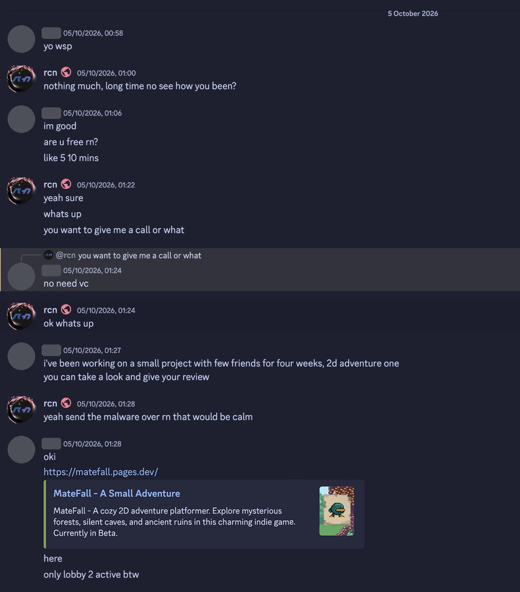
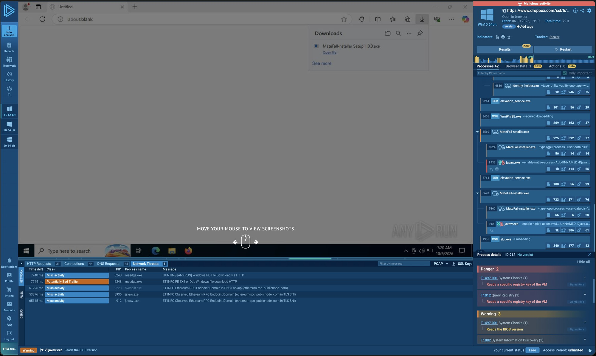

In early October one of my friends had their Discord account stolen. They had downloaded a game called "MateFall" from a site that looked like a small indie studio's page: "a cozy 2D adventure platformer", currently in beta. The game never opened, and soon after, someone else had their Discord account.

Then the account came for me. Just before 1am on 5 October it messaged me, turned down a call, and pitched a game it had been "working on with few friends for four weeks":



The account told me to check VirusTotal, which showed zero detections, so it was almost believable.

I wanted to know what had actually run on my friend's PC, so I took the malware apart with Claude's help. The usual way of reading Java malware failed on it. What worked was letting the malware decrypt its own strings and catching them as it did.

## The infection chain

There are five steps between clicking Download and losing your account.

1. The lure is `matefall[.]pages[.]dev`, a Cloudflare Pages site dressed up as an indie game. The comments in its code are in Turkish, and the page script comes from a template called "HAISE". By the time I looked, Cloudflare was already showing a warning page in front of it.
2. The Download button first looks up the visitor's IP address and location (with ipapi.co, falling back to api.ipify.org) and posts them to a Discord webhook, so the operators know who took the bait. Then it fetches the installer from a Dropbox link.
3. The installer, `MateFall-nstaller Setup 1.0.0.exe` (the missing "I" is theirs), is 155 MB. It's an NSIS installer (a common Windows installer format), and inside it is an Electron app (a desktop app built from web code, like Discord itself) plus a complete Java 21 runtime.
4. The Electron app has one real file, `index.js`, run through an obfuscator. It starts Java in the background, hidden and detached, with the malware jar and one argument: `ira-ed6140ab`. No game window ever appears.
5. The stealer itself is a 35 MB Java jar, which does everything else.

I opened every layer without running it. 7-Zip unpacks NSIS installers, and Electron's own `asar` tool unpacks the app archive, so I could read each layer as plain files. The launcher shows the style of the whole thing. Every name becomes `_0x…` and every string is pulled from a shuffled, encoded table:

```js
const _0x518f02=_0x5328;(function(_0x368524,_0x417342){const _0x18b481={_0x283cf0:0xac,
_0x1ea51b:'qO4#',_0x2af2db:0xc6,_0xe3dc03:'t!RU',_0x3b2d88:'cgXE',…},_0x41dac8=_0x5328,
_0x429918=_0x368524();while(!![]){try{const _0x427f0f=parseInt(_0x41dac8(_0x18b481._0x283cf0,…
```

Under all that, the 7,894-byte file starts `javaw` hidden and detached, with the jar, the entry class `V` and the argument `ira-ed6140ab`.

## Why reading the code didn't work

The usual way to study Java malware is to decompile it: turn the compiled `.class` files back into readable Java source. Java is normally easy to decompile because its compiled form keeps a lot of structure.

This jar was built to defeat that. Its own code lives in a package with the Turkish name `izini_birakir_arkasinda_geceler`, alongside normal libraries (OkHttp for web requests, JNA for calling Windows functions, a SQLite driver for reading browser databases). I ran the [Vineflower](https://github.com/Vineflower/vineflower) decompiler over its 176 classes and got 48 MB of "source" back, full of errors like `Statement cannot be decomposed although reducible!`. The entry class, `V`, wouldn't decompile at all.

The raw bytecode showed why: three layers of obfuscation, stacked on top of each other.

- The strings are encrypted. Dozens of classes carry their own encrypted block of strings, and 71 of them reference `Cipher`, `PBEKeySpec` and `SecretKeyFactory` (Java's encryption classes). None of the interesting text (URLs, file paths, messages) appears in the file; it only exists in memory once the class has decrypted it.
- The calls are hidden. Instead of calling methods directly, 140 classes look them up at runtime through `MethodHandles` (a way to find and call a method by name while the program runs). If the method's name isn't decided until then, a decompiler can't show you what the call does.
- The control flow is scrambled. Simple logic is padded with arithmetic that always comes out the same way, which buries the real path through each method.

Here is the start of one method in `V`, as `javap` (the JDK's bytecode viewer) prints it:

```
 0: ldc   #31     // int 842601993
 2: ldc   #32     // int -442876292
 4: dup2
 5: ior
 6: dup_x2
 7: pop
 8: iand
 9: isub          // (a | b) - (a & b), which is just a XOR b
10: istore 4
12: ldc   #33     // int 298099655
   …
26: if_icmplt 7588
29: aconst_null
30: athrow
```

The first nine instructions are an XOR written the long way round. The next block undoes it, so the comparison at line 26 always works out to `298099655 < 842601993`. The jump is always taken, and the `athrow` after it never runs. Every method is full of branches like this that look like decisions but aren't, and working through them by hand would have taken weeks.

## The trick: let it decrypt itself

To use its strings, the malware has to decrypt them, and it does that with Java's standard `Cipher.doFinal` method. Every secret passes through that one method in plain text, right after decryption.

So I stopped reading the code and watched it run. Java supports agents: small programs passed with `-javaagent` that load before the main program and can rewrite classes as they load. I wrote one with [Byte Buddy](https://bytebuddy.net) (a library for exactly this) that hooks a handful of standard Java methods and logs every call:

- `Cipher.doFinal`, to record every decrypted string block;
- `MethodHandles.Lookup.find*`, to record which real method each hidden call resolves to;
- `ProcessBuilder.start` and `Runtime.exec`, to record any program it tries to launch;
- the `File`, `Path` and `URL` constructors, to record every file and address it touches.

Here is the core of the agent, trimmed:

```java
new AgentBuilder.Default()
    .disableClassFormatChanges()
    .with(AgentBuilder.RedefinitionStrategy.RETRANSFORMATION)
    .ignore(none())
    .type(named("javax.crypto.Cipher"))
    .transform((b, td, cl, m, pd) ->
        b.visit(Advice.to(CipherAdvice.class).on(named("doFinal"))))
    .type(named("java.lang.invoke.MethodHandles$Lookup"))
    .transform((b, td, cl, m, pd) ->
        b.visit(Advice.to(LookupAdvice.class).on(nameStartsWith("find").and(isPublic()))))
    // ... ProcessBuilder, Runtime, URL, File, Path
    .installOn(inst);

public static class CipherAdvice {
    @Advice.OnMethodExit(onThrowable = Throwable.class)
    static void exit(@Advice.This Object self, @Advice.Return Object ret,
                     @Advice.AllArguments Object[] args) {
        HookLog.cipher(self, ret, args);   // ret is the decrypted bytes
    }
}
```

`CipherAdvice` is copied into `Cipher.doFinal` itself, so it runs every time `doFinal` returns and gets to see its return value: the plaintext.

### Running malware safely

Running a credential stealer on purpose needs a sandbox you trust. I used a Docker container (through Colima on my Mac), locked down as far as it would go:

```sh
docker run --rm --network none --cap-drop ALL \
  --security-opt no-new-privileges --memory 1g --pids-limit 256 \
  --user 65534:65534 \
  -v "$PWD/payload/.../9c54682785d1.jar:/mal/mal.jar:ro" \
  -v "$PWD/tools/agent/agent.jar:/agent/agent.jar:ro" \
  -v "$PWD/run2:/out" \
  eclipse-temurin:21-jdk \
  timeout 120 java -javaagent:/agent/agent.jar ... -cp /mal/mal.jar V ira-ed6140ab
```

Each flag closes off one way out:

- `--network none`: no network at all, so nothing can be sent anywhere.
- `--cap-drop ALL` and `no-new-privileges`: the process gets no special Linux permissions and can't gain any.
- `--user 65534`: it runs as `nobody`, not root.
- Memory and process limits, plus `timeout`, so it can't run away.
- The jar is mounted read-only, and the only writable folder is the output folder.

There's one more layer of safety for free: the container runs Linux, and the stealer targets Windows. Every part that calls a Windows system library (`advapi32`, `user32`, `kernel32`) fails to load, so it can't touch anything even in principle.

### Getting it to work

The first runs failed for three reasons.

- Java's own classes (like `Cipher`) are loaded by a different class loader from the agent, so the hooks couldn't see the logging code. Putting the agent's jar on the bootstrap path in its manifest, where Java's own classes can reach it, fixed that.
- The hook hooked itself. One hook used a Java lambda, and creating a lambda goes through `MethodHandles.Lookup`, the very method being hooked. Rewriting it as a plain anonymous class with a null check stopped the loop.
- Most of the code never ran. With no network and no Windows, the malware gave up early, before loading most of its modules. So the agent waits 15 seconds and then loads every class in the jar itself. Loading a class runs its setup code, and the setup code decrypts that class's strings.

The final run loaded 225 classes (24 failed because they need Windows libraries) and caught 328 decrypted string blocks at `Cipher.doFinal`. The hidden-call log showed the same pattern 112 times: get a key, initialise a cipher, call `doFinal`. Turning the decrypted bytes back into text gave me the malware's whole vocabulary: log messages, file paths, URLs, Discord message templates, its build version (`2025-08-30-V11`) and Turkish strings like `Sonuç` ("result") and `VERİ YOK` ("no data").

Each line of the hook's log is one decrypted block. Here is the entry class's:

```
[CIPHER AES/CBC/PKCS5Padding] V.IliIlllilIi -> hex:00096e65742d636865636b001c2e657468202d3e
20657761207265636f7264202d3e204332292e2e2e000e2d2d746573742d656c6576617465…(1017B)
```

The bytes are a list of strings, each starting with its length in two bytes:

| Length | Text |
|---|---|
| `0009` (9) | `net-check` |
| `001c` (28) | `.eth -> ewa record -> C2)...` |
| `000e` (14) | `--test-elevate` |

The rest of that block reads `build-version:`, `ens-refresh`, `ANTIVM`, `--inj`, `2025-08-30-V11`, `C2TEST` and `ewa.test`: the program's command-line flags, its build and its test switches, none of which can be read from the jar on disk.

## What it does

Once the strings were readable, I could see what it takes:

- Saved passwords, cookies, card details, history and autofill from Chrome, Edge, Brave, Opera and Opera GX, Firefox, Waterfox, Pale Moon, Yandex and Vivaldi. It reads their SQLite databases and unlocks the encrypted values with Windows' own DPAPI (the Windows feature that encrypts data for the logged-in user).
- Discord login tokens from Discord's local storage, Canary included. It also injects JavaScript into the Discord app that attaches the developer tools debugger to Discord's window and records login, registration, 2FA and backup-code requests. While that injection is in place, changing your password on the infected PC would just hand over the new one.
- The Roblox `.ROBLOSECURITY` cookie, followed by a lookup of the account's Robux, limited items and Premium status.
- Crypto wallets: Exodus (it patches the wallet app's own code), Electrum, Guarda, Binance and Dash.
- Telegram sessions, VPN configs, SSH keys and game data.

It also gives the attacker remote access: a hidden desktop (HVNC, a second, invisible Windows desktop the attacker can use without you seeing), screenshots and the webcam.

To stay hidden, it checks for virtual machines and sandboxes and for Avast, AVG, Kaspersky and Malwarebytes. It carries embedded x64 shellcode too, with launch flags for elevating its privileges (`--test-elevate`) and injecting (`--inj`).

Results go to Discord webhooks as formatted messages, with the victim's hardware ID and counts of cookies, passwords and cards. Archives over 8 MB go to gofile.io instead.

### A command server on the blockchain

The most interesting part is how it finds its command server. Normally malware has a server address written into it, and that address gets taken down: a registrar suspends the domain, a host deletes the server.

This one reads an [ENS](https://ens.domains) record instead. ENS is a naming system that lives on the Ethereum blockchain, a bit like DNS. The malware asks two public Ethereum gateways (`ethereum-rpc.publicnode.com` and drpc) for a text record called `ewa` on its ENS name, and logs a warning if their answers differ. The record is encrypted with AES-GCM using a per-customer key. Decrypted, it gives an HTTPS server and a WebSocket address (`wss://…/ws`) to connect to.

The resolver class's decrypted strings show the mechanism. These are fragments exactly as they came out of `doFinal`:

```
{"jsonrpc":"2.0","method":"eth_call","para
0178b8bf
59d1d43c
AES/GCM/NoPaddi
_decr: AES-GCM decrypt FAILED
RPC mismatch - drpc vs publicno
de differ, preferring publicnod
wss://
/ws
```

The first line is the start of an Ethereum API request. `0178b8bf` and `59d1d43c` are the function IDs for ENS's `resolver(bytes32)` and `text(bytes32,string)`: first find which contract holds the name's records, then read the text record from it.

There's no registrar or host to report a blockchain record to. When a server gets shut down, the operators publish a new encrypted record and every infected machine follows it. The per-customer key and strings like `ira-777-prime` suggest the stealer is sold as a service to several buyers, each with their own key and server.

I never decoded the ENS name itself, so the command server stayed hidden. An [ANY.RUN](https://any.run) sandbox run of the installer did confirm the behaviour from the outside: within about a minute, the Java process was connecting to `ethereum-rpc.publicnode.com`.



## Reporting it

Once I knew what it was, I reported every piece of infrastructure I could find:

- VirusTotal: both the installer and the jar had zero detections when I checked. That's what the obfuscation is for. (It changed later; see the end of the post.)
- Cloudflare: Trust & Safety restricted `matefall.pages.dev` and forwarded the report to the site's owner.
- Dropbox, URLhaus, Microsoft (Defender) and Google Safe Browsing: submitted.
- MalwareBazaar: banned my account. It only accepts samples within 10 days of their first sighting, and this one was first seen on 20 September 2026, so the upload broke its rules. I appealed and the ban was lifted.
- Telegram: the `@irahook` channel named in the strings was already gone.
- Discord: bot replies only. The route that actually works is the victim's own "hacked account" ticket, which my friend filed.

## If you ran something like this

Assume everything in your browsers and Discord is stolen, and work from a different, clean device:

1. Change your passwords, starting with email, then Discord and anything with saved cards. Turn on 2FA with an app, not SMS.
2. Log out every other session (Discord, Google, Steam and so on) and revoke app passwords.
3. Move any crypto to a new wallet created on the clean device.
4. Reinstall Windows on the infected PC. With an injected Discord client and a hidden desktop, cleaning it by hand isn't worth the risk.
5. Warn your friends. The attacker now has your contacts and can message them as you, which is how this one reached me.

## What I took from it

Against obfuscation this heavy, watching the code run worked far better than reading it. Every encrypted string has to be decrypted before use, so hooking the decryption method got me everything the code hides without my reading a line of it.

A clean VirusTotal scan meant very little here. Zero detections only showed that the file was new and well hidden, and weeks later most engines still miss the jar.

Most of this campaign could be reported: the Pages site, the Dropbox link, the Discord webhooks. The command server's address lives in a blockchain record, and there is nobody to report that to.

## A few weeks later

When I looked on 2026-10-06, VirusTotal showed no detections for either file. Its most recent scans (the installer on 2026-10-11, the jar on 2026-10-08) flag both, though not equally.

The installer is flagged by 21 of 66 engines, mostly under generic names like `Trojan.GenericKDQ` and `Win32:Malware-gen`; Malwarebytes names it exactly, as `Spyware.InfoStealer.Electron`. The jar is flagged by only 6 of 67 (ESET, Kaspersky, Ikarus, Google, Alibaba and Kingsoft). Microsoft's, CrowdStrike's and SentinelOne's engines missed both files in those scans.

So scanners now catch the wrapper and mostly miss the payload. The installer and its Electron launcher look like plenty of other malware, while the encrypted jar still gives them very little to match on.

The file history adds two more things. Both files were first uploaded on 2026-09-20, sixteen days before I saw them, so this campaign was already running before my friend found it. And the installer has also been submitted as `Nicht bestätigt 53763.crdownload`, the name a German-language Chrome or Edge gives a download that hasn't finished, which suggests at least one other person downloaded it too.

The live VirusTotal reports are linked in the table below.

## Indicators

| Type | Value |
|---|---|
| Lure site | `hxxps://matefall[.]pages[.]dev` |
| Installer | `MateFall-nstaller Setup 1.0.0.exe`, 154,830,210 bytes |
| Installer SHA-256 | `0f6877a18422f6fb7223f095b775f7a43a2b8e27659e74877e9ef60ca43457d3` ([VirusTotal](https://www.virustotal.com/gui/file/0f6877a18422f6fb7223f095b775f7a43a2b8e27659e74877e9ef60ca43457d3)) |
| Jar | `resources/java/9c54682785d1.jar`, 35,275,704 bytes |
| Jar SHA-256 | `76af97e5f858949c702a9e3a54fbcb52700374241be4de4c0ac078435bccbb60` ([VirusTotal](https://www.virustotal.com/gui/file/76af97e5f858949c702a9e3a54fbcb52700374241be4de4c0ac078435bccbb60)) |
| Launch | `javaw --enable-native-access=ALL-UNNAMED --add-opens java.base/java.lang=ALL-UNNAMED -cp 9c54682785d1.jar V ira-ed6140ab` |
| Download | Dropbox path `scl/fi/5f11m34f13trts6jj7rhi/MateFall-nstaller-Setup-1.0.0.exe` |
| C2 lookup | ENS text record `ewa`, via `ethereum-rpc[.]publicnode[.]com` and drpc |
| HTTP markers | header `x-ira-id: ira-777-prime`; user agents `irahook-client/1.0`, `ewahook-client` |
| Code markers | package `izini_birakir_arkasinda_geceler`; strings `ewa-key-777`, `ewa.test`; build `2025-08-30-V11` |
| Exfiltration | Discord webhooks; gofile.io for archives over 8 MB |
